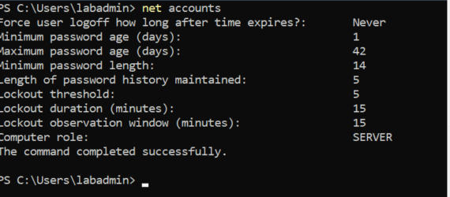
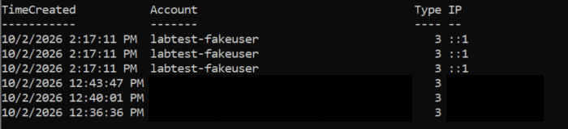

# Endpoint Security Lab (Azure): Windows Server Baseline and Hardening

## Goal
Build a small Windows Server in Azure, record its security baseline, apply password and account-lockout hardening, and confirm that failed logons are audited so they can be detected later.

## Environment
- Azure for Students subscription (identifiers redacted)
- VM: `vm-endpoint-lab`, Windows Server 2022 Datacenter, `Standard_D2s_v3`, East US 2
- Access: Remote Desktop (3389) allowed **only from my single public IP** through a network security group rule; no other inbound rules
- Tooling: Azure CLI, PowerShell, Remote Desktop client
- Cost control: a monthly cost budget with alerts at 50% and 80% of actual spend was created before the VM

## Steps performed
1. **Cost guardrail first.** Created a $25/month budget (`lab-budget`) with email alerts at 50% and 80%.
2. **Provider and quota troubleshooting.** The first VM attempts failed with `QuotaExceeded` (zero cores). The `Microsoft.Compute`, `Microsoft.Network` and `Microsoft.Storage` resource providers were not registered on the new subscription; registering them created normal regional quota.
3. **Region policy.** A West US 2 attempt was rejected by the subscription policy "Allowed resource deployment regions" (eastus, eastus2, southcentralus, westus3, canadacentral). Redeployed in East US 2.
4. **VM created** with the admin password typed locally at the CLI prompt (never stored in a file or script), with no inbound rules (`--nsg-rule NONE`).
5. **Network lockdown.** Added one NSG rule allowing TCP 3389 only from my current public IP (/32).
6. **Baseline.** Connected over RDP and recorded the starting security posture (table below).
7. **Hardening.** Raised the local password and lockout policy and verified the new values.

## Baseline (before changes)
| Check | Result |
|---|---|
| Firewall (Domain / Private / Public) | On / On / On |
| Microsoft Defender real-time protection | On |
| Audit policy "Logon" | Success and Failure |
| Audit policy "Account Lockout" | Success and Failure |
| Minimum password length | 0 |
| Password history | None |
| Minimum password age | 0 days |
| Account lockout threshold | 10 attempts |
| Lockout duration / observation window | 10 min / 10 min |

Because failure auditing for logon events was already enabled, failed sign-ins (Windows Security event ID 4625) are recorded without extra configuration.

## Hardening applied
```powershell
net accounts /minpwlen:14 /uniquepw:5 /minpwage:1 /lockoutthreshold:5 /lockoutduration:15 /lockoutwindow:15
```

| Setting | Before | After |
|---|---|---|
| Minimum password length | 0 | 14 |
| Password history | None | 5 |
| Minimum password age | 0 days | 1 day |
| Lockout threshold | 10 | 5 |
| Lockout duration | 10 min | 15 min |
| Lockout observation window | 10 min | 15 min |

The new values were read back with `net accounts` after the change:



## Failed-logon test and detection
**Test.** Three network logon attempts (`net use \\localhost\IPC$`) were made with a non-existent account name and wrong passwords. Reading the Security log back showed three event ID 4625 entries:

| Field | Value |
|---|---|
| Account | `labtest-fakeuser` (does not exist) |
| Logon type | 3 (network) |
| Status | `0xC000006D` (logon failure) |
| Sub-status | `0xC0000064` (user name does not exist) |
| Source | `::1` (the VM itself) |

Most recent 4625 events on the VM (times are the VM's clock). The three test rows are at the top; the rows below are my own earlier Remote Desktop sign-in attempts, with account names and source IPs blacked out:



Using an account that does not exist avoids locking out the real admin account, and the sub-status tells a defender the name was invalid rather than the password being wrong.

**Detection.** `queries/failed-logons.ps1` collects 4625 events from the last 24 hours, groups them by account, logon type and source IP, and flags any group with three or more failures. **Result of running the query on the VM.** It returned two groups: the three test failures (`labtest-fakeuser`, type 3, source `::1`) and **four failures from my own public IP** against a personal account name (redacted), logon type 3. Those four were my own mistyped Remote Desktop sign-ins before I used the correct local account format, so the query caught real activity, and the source IP showed it came from the one address allowed through the firewall rule.

These events exist only in the VM's local Security log; they are not yet forwarded to a central log store.

## Lessons learned
- **Set the budget before the first resource.** A cost alert does not stop spending, so the VM must also be stopped or deleted when not in use.
- **New subscriptions may have unregistered resource providers.** Zero quota can be a registration problem, not a plan limit.
- **Subscription policies can restrict regions.** The CLI traceback hid the real cause; the activity log showed the policy message.
- **Check the actual state, not the screen.** A paused console ("Select" mode) made commands appear to run when they had not. I re-read the settings from the VM and applied them before recording them.
- **Least exposure by default:** create the VM with no inbound rules, then add a single source-restricted rule.

## Cleanup
Stop billing when the VM is idle, and remove it when the lab ends:
```powershell
az vm deallocate --resource-group <resource-group> --name vm-endpoint-lab
az vm delete --resource-group <resource-group> --name vm-endpoint-lab --yes
```
